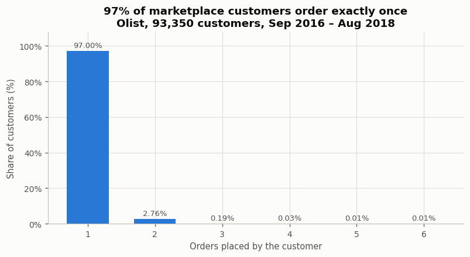
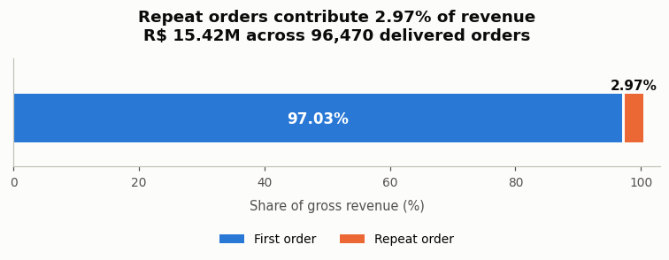
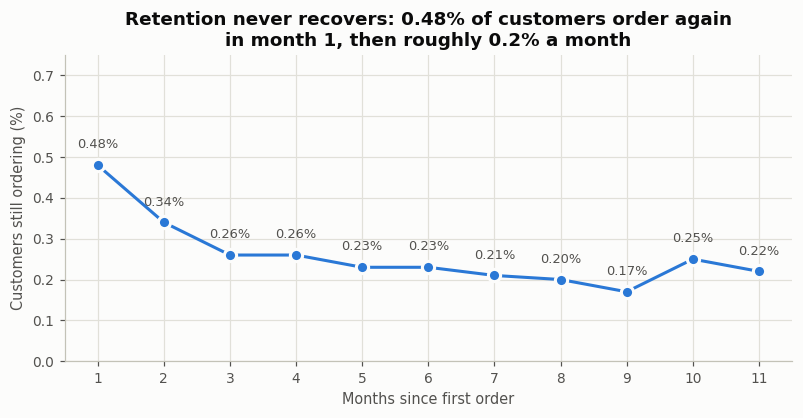
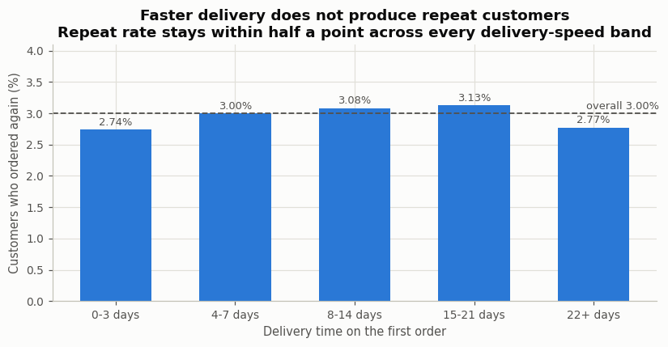
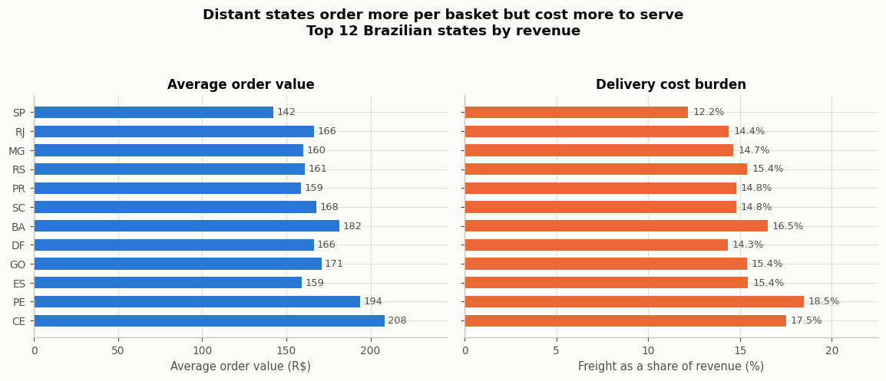
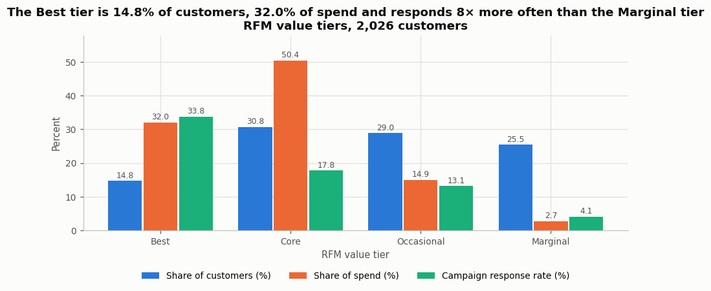
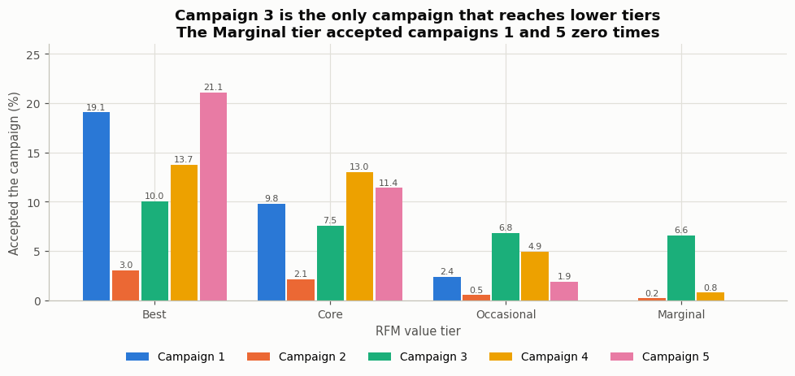
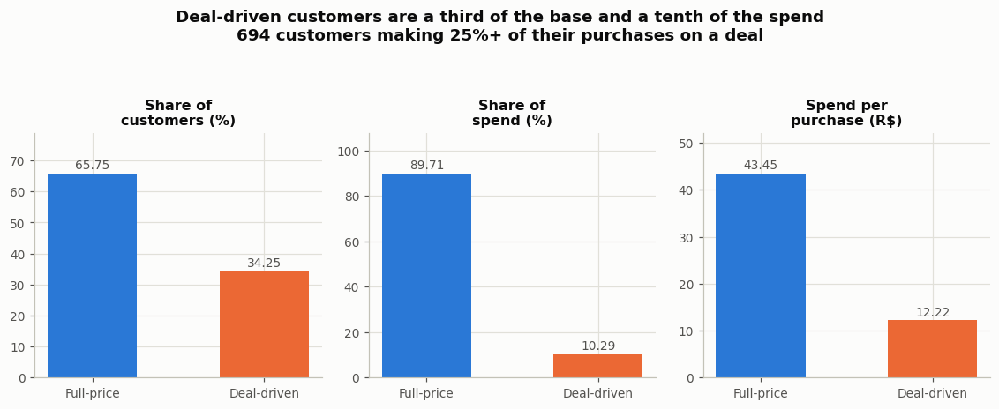
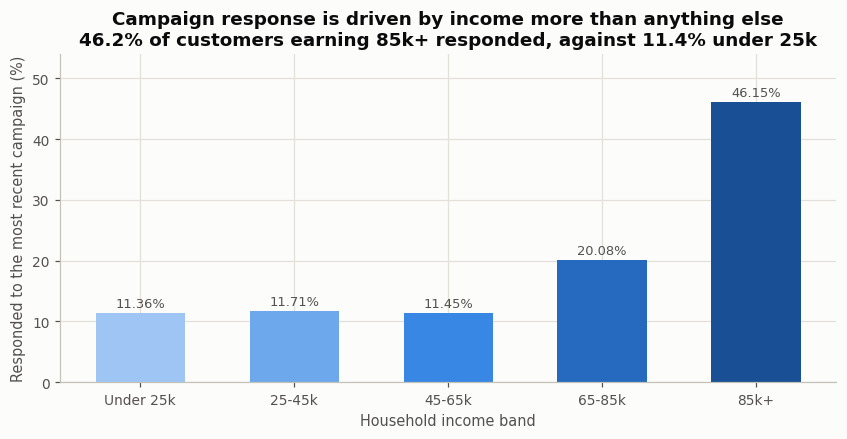

# E-Commerce Growth Analytics
### Acquisition Economics & Campaign Response

**Project owner and author: Pranit Ajay Chaudhari** — BBA student (Marketing and Finance), with
Python and SQL as technical skills. **Project 3** of my analytics portfolio.

> **96,470 marketplace orders · 93,350 customers · R$ 15.42M · 27 Brazilian states · 74 categories**
> **+ 2,026 customers across 6 marketing campaigns**
> Python · MySQL · Excel
>
> **96.97% of marketplace customers never place a second order**, so RFM segmentation is tested and
> shown to be the wrong tool — then applied properly to a second dataset where it works.



---

## 1. The business problem

A marketing team has a fixed budget and three places to put it: **acquiring** new customers,
**retaining** existing ones, and running **promotional campaigns**. Most customer-analytics work
assumes retention is the answer and segments the existing base. This project tests that assumption
instead of inheriting it.

- **Part A** asks what a marketplace's own order data says about where growth actually comes from,
  which customers and regions are worth acquiring, and what makes a first-time buyer come back.
- **Part B** asks, for a retailer that *does* have a repeat-purchase base, which segments respond
  to campaigns, which only buy on discount, and what that means for targeting and margin.

The deliverable is a budget recommendation with the numbers behind it.

## 2. Why two datasets, and why they are never joined

No single public dataset I could obtain covers the whole question. Olist has scale, geography and a
real relational structure but **no campaigns and no discounts**; the campaign dataset has campaigns,
discounts and demographics but is small and has no geography. Each carries the half it is genuinely
good at.

**They are kept completely separate.** They describe different companies, in different countries,
in different years, and share no customer, product, date or geography key. No query, formula or
chart in this project combines them, and the SQL schema deliberately has no foreign key between
them. Where both are discussed, it is as a comparison of two business situations — never as one
merged dataset. Full reasoning: [`docs/METHODOLOGY.md`](docs/METHODOLOGY.md).

## 3. Datasets

| | Part A | Part B |
|---|---|---|
| **Name** | Brazilian E-Commerce Public Dataset by Olist | Marketing Campaign / Customer Personality |
| **Unit** | Order and order line | Customer |
| **Size** | 99,441 orders → **96,470 delivered orders**, **93,350 customers** | 2,240 records → **2,026 customers** |
| **Window** | Sep 2016 – Aug 2018 | Enrolled Jul 2012 – Jun 2014 |
| **Tables** | 8 related CSVs | 1 flat file |
| **Licence** | CC BY-NC-SA 4.0 (Olist) | Public dataset, publisher unnamed in the file |

Neither dataset is mine. Sources, licences, SHA-256 of every file and the known quality problems:
[`data/raw/README.md`](data/raw/README.md).

**One change was made to the raw data before committing it.** The published Olist review file
contains **nine real email addresses** that customers typed into free-text comments. Since this
project reads `review_score` and never the comment text, `python/00_prepare_raw.py` removes those
two free-text columns and masks one affected seller city, then re-scans and refuses to pass if any
address remains. Both the original and prepared checksums are published so provenance stays
verifiable.

## 4. Tools

| Tool | Role |
|---|---|
| **Python 3** (pandas, numpy, matplotlib, openpyxl) | cleaning, all analysis, the charts, and the Excel workbook |
| **MySQL 8 / MariaDB** | a 7-table star schema, and 17 business queries using multi-table joins, CTEs and window functions |
| **Excel** | an independent rebuild of the headline figures and of the RFM scoring, entirely in formulas |

**No Power BI.** Power BI Desktop is Windows-only and cannot be verified in the environment this
was built in, so rather than ship files and screenshots nobody has checked, it is not part of this
project at all.

## 5. The central finding of Part A

The first thing the analysis does is **test whether RFM segmentation applies**, rather than assume
it:

| Check | Result |
|---|---|
| Customers | 93,350 |
| Customers with exactly one order | **90,549** |
| Share with exactly one order | **96.97%** |
| Customers with 2+ orders | 2,801 (3.00%) |
| Maximum orders by one customer | 15 |

An RFM model scores Frequency 1–5. Here, **97% of customers would land in a single bucket**, so the
F dimension carries almost no information and the segmentation would be a recency-and-money model
wearing an RFM label. **Classical RFM is the wrong tool for this business**, and the project says so
and uses a first-order-value framework instead.

That is not a failure of the dataset — it is the finding. This is an **acquisition business**, not a
retention business, and it should be managed as one.

## 6. Part A — key results



| Metric | Value |
|---|---|
| Gross revenue | **R$ 15,418,394.83** |
| Average order value | R$ 159.83 (median R$ 105.28) |
| Revenue from first orders | **97.03%** |
| Average first-order value | R$ 160.26 |
| Revenue per acquired customer | R$ 165.17 |
| **Retention contributes** | **R$ 4.91 per customer — 2.97% of their value** |
| Top 20% of customers | 53.53% of revenue |
| Average delivery time | 12.09 days |
| Late deliveries | 6.77% |
| Average review score | 4.14 / 5 |
| Orders paid in instalments | 51.47% |

### Retention does not recover



**0.48%** of a cohort orders again in the month after their first purchase, and roughly **0.2% a
month** after that. The curve is flat because there is nothing to decay.

*(This figure is customer-weighted. An unweighted mean of cohort percentages reports 5.45%, because
the December 2016 cohort contains **one** customer who happened to order again — a 100% retention
rate on a single person. Cohorts under 100 customers are excluded. The error is recorded here
because it is exactly the kind that survives into a published report.)*

### Customer experience does **not** buy loyalty here



This is the result I most expected to go the other way:

| Comparison | Repeat rate | Difference | p-value | Verdict |
|---|---|---|---|---|
| On-time vs late first delivery | 3.03% vs 2.55% | 0.49 pp | 0.0286 | Statistically detectable, **commercially negligible** |
| 5-star vs 1-star first review | 3.11% vs 2.87% | 0.24 pp | 0.2071 | **Not statistically significant** |

A 1-star first experience costs about a quarter of a percentage point of repeat rate on a 3% base.
The usual "delight customers and they come back" argument does not show up in this data, because
there is barely any repeat behaviour for it to explain. Fixing delivery is still worth doing — for
reviews, refunds and marketplace reputation — but **it should not be sold internally as a retention
investment.**

### Geography: distant states pay more and cost more



| State | Customers | Revenue | % | AOV | Freight share | Delivery days | Review | Repeat |
|---|---|---|---|---|---|---|---|---|
| SP | 39,138 | R$ 5.77M | 37.4% | R$ 142.48 | 12.2% | 8.3 | 4.23 | 3.11% |
| RJ | 11,913 | R$ 2.06M | 13.3% | R$ 166.42 | 14.4% | 14.9 | 3.95 | 3.27% |
| MG | 10,998 | R$ 1.82M | 11.8% | R$ 160.18 | 14.7% | 11.6 | 4.18 | 2.95% |
| BA | 3,158 | R$ 0.59M | 3.8% | R$ 181.54 | 16.5% | 18.9 | 3.91 | 2.85% |

São Paulo alone is 37% of revenue with the cheapest freight and fastest delivery. The north and
north-east order **larger baskets** but carry freight at 17–21% of revenue, wait three times as long
and rate the experience lower. Acquisition spend is worth more per rupee in the south-east; serving
the north profitably is a logistics problem before it is a marketing one.

### Other Part A findings

- **Instalments carry the large baskets.** Average order value rises from R$ 120.21 on a single
  payment to R$ 414.31 at 13+ instalments — a 3.4× spread. Instalment availability is a
  basket-size lever, not a discount.
- **The marketplace is concentrated.** 2,970 sellers; the top 1% take **25.5%** of revenue and the
  top 10% take **66.3%**. 133 sellers produce half of everything sold.
- **Growth is acquisition.** Over Jan 2017 – Jul 2018, **98.1%** of monthly active customers were
  first-time buyers.

## 7. Part B — key results

Here frequency genuinely varies (0–32 purchases, median 12, only 0.2% with a single purchase), so
**RFM is applied properly** with frozen quintile bands reproduced identically in Python, SQL and
Excel.



| Tier | Customers | % | % of spend | Avg spend | Response rate | Lift |
|---|---|---|---|---|---|---|
| **Best** | 299 | 14.8% | **32.0%** | R$ 1,317.97 | **33.78%** | **2.21×** |
| Core | 623 | 30.8% | 50.4% | R$ 995.47 | 17.82% | 1.16× |
| Occasional | 587 | 29.0% | 14.9% | R$ 313.02 | 13.12% | 0.86× |
| Marginal | 517 | 25.5% | **2.7%** | R$ 63.26 | 4.06% | 0.27× |

### Campaigns do not all target the same people



| Campaign | Accepted | Rate | Avg spend of accepters | % with children |
|---|---|---|---|---|
| Campaign 1 | 132 | 6.52% | R$ 1,492 | 22.7% |
| Campaign 2 | 26 | 1.28% | R$ 1,324 | 34.6% |
| Campaign 3 | 151 | 7.45% | R$ 721 | **70.2%** |
| Campaign 4 | 155 | 7.65% | R$ 1,104 | 60.0% |
| Campaign 5 | 145 | 7.16% | R$ 1,615 | 15.2% |
| Most recent | 310 | 15.30% | R$ 979 | 49.4% |

Campaigns 1 and 5 reach **high-spending, mostly childless** customers. Campaign 3 reaches a
completely different group — **70% have children and they spend half as much**. The Marginal tier
accepted campaigns 1 and 5 **zero times**. Campaigns are not interchangeable and should not be
evaluated on a single blended response rate.

### Discount dependence



| | Customers | % of base | % of spend | Spend per purchase | Avg income |
|---|---|---|---|---|---|
| Full-price | 1,332 | 65.8% | **89.7%** | R$ 43.45 | R$ 60,216 |
| Deal-driven | 694 | **34.2%** | **10.3%** | **R$ 12.22** | R$ 36,310 |

A third of the customer base produces a tenth of the spend, and their basket is worth **3.6× less
per purchase**. Contacting them with discounts buys volume at a margin the basket does not support.

### Income predicts response better than anything else



Response runs from 11.36% (under R$ 25k) to **46.15% (R$ 85k+)** — a 3.02× lift. Customers with no
children respond at **27.59%** against 10.50% for those with children, and spend 2.7× more.

## 8. Business recommendations

| # | Finding | Recommendation |
|---|---|---|
| 1 | 97% of marketplace customers never return; retention adds R$ 4.91 per customer | **Do not fund a loyalty programme.** There is no repeat base to retain. Judge acquisition on first-order contribution, not projected lifetime value |
| 2 | Late delivery costs 0.49 pp of a 3% repeat rate | Fix delivery for reviews and refunds — but **stop justifying it as a retention investment**, because the data does not support that |
| 3 | SP is 37% of revenue at 12.2% freight; northern states carry 17–21% freight and 19–21 day delivery | Concentrate acquisition spend in the south-east; treat the north as a **logistics problem** to solve before spending to acquire there |
| 4 | Instalments lift AOV 3.4× | Promote instalment availability on high-ticket categories — a basket-size lever that costs no margin |
| 5 | Top 10% of sellers carry 66% of revenue | Seller retention is worth more than customer retention in this model. Protect the top 133 sellers |
| 6 | Part B: Best tier is 14.8% of customers and 32% of spend, responding at 2.21× | **Concentrate campaign budget here**, with full-margin offers |
| 7 | Part B: Marginal tier is 25.5% of customers, 2.7% of spend, 4.06% response | **Suppress from paid campaigns.** Contact cost is not recovered |
| 8 | Part B: deal-driven customers are 34% of the base and 10% of spend | Move to non-price offers or stop contacting. Discounting this group buys unprofitable volume |
| 9 | Campaign 3 reached families; campaigns 1 and 5 reached affluent childless customers | **Match offer to segment.** A single blended response rate hides that these are different audiences |

Full reasoning: [`docs/BUSINESS_INSIGHTS.md`](docs/BUSINESS_INSIGHTS.md).

## 9. Verification

All three tools are checked against each other rather than assumed to agree —
**69 of 69 cross-tool checks pass**, including all 27 states × 5 metrics, and Excel's independent
nested-IF rebuild of the RFM scoring disagrees with Python on **0 of 2,026 customers**.

Two real defects were found this way and fixed **in the code**, not papered over in the docs:
a SQL repeat rate that double-counted repeat customers across a join, and a state table that mixed
two different grains. Both are documented in [`docs/VERIFICATION.md`](docs/VERIFICATION.md).

```
python python/08_verify.py     # exits non-zero if any figure disagrees
```

## 10. How this project differs from Projects 1 and 2

Project 1 is also customer segmentation, so the difference matters and is set out in full in
[`docs/DIFFERENTIATION.md`](docs/DIFFERENTIATION.md). In short: Project 1 analyses a business with a
**72.4% repeat rate** and segments a loyal base; this project analyses one with a **3.0% repeat
rate** and argues against doing that. Same toolkit, opposite diagnosis. This project also adds
delivery performance, review scores, payment instalments, seller concentration, campaign response,
discount dependence and demographics — none of which exist in Project 1's dataset, as its own
README states.

## 11. Project structure

```
Project-3-Ecommerce-Growth-Analytics/
├── README.md · RESULTS.md · RESUME_BULLETS.md · LICENSE · requirements.txt · run_all.sh
├── data/
│   ├── raw/        8 Olist CSVs + marketing_campaign.csv, README.md, SHA256SUMS.txt
│   │                (review comment text removed - it contained real email addresses)
│   └── cleaned/    partB_customers + 2 cleaning logs (the 47 MB Part A tables are
│                    regenerated by run_all.sh, not committed - see data/cleaned/README.md)
├── python/
│   ├── 00_prepare_raw.py        one-time privacy step: strips personal data from the raw files
│   ├── 01_clean_partA.py        8 raw tables -> order, item and customer tables
│   ├── 02_clean_partB.py        2,240 -> 2,026 customers, every drop logged
│   ├── 03_analysis_partA.py     acquisition economics
│   ├── 04_analysis_partB.py     RFM, campaigns, discount behaviour
│   ├── 05_build_charts.py       12 charts
│   ├── 06_run_sql.py            runs the SQL project and exports results
│   ├── 07_build_excel.py        the Excel workbook
│   ├── 08_verify.py             cross-tool verification (exits 1 on disagreement)
│   └── 09_recalc_excel.py       portable LibreOffice formula recalculation
├── sql/
│   ├── 01_create_schema.sql · 02_import_data.sql · 03_business_queries.sql
│   └── query_results/           q01 … q17 CSV outputs
├── excel/Ecommerce_Growth_Analytics.xlsx
├── outputs/tables/              every table the documentation quotes
├── docs/                        METHODOLOGY · DATA_CLEANING · BUSINESS_INSIGHTS · VERIFICATION · DIFFERENTIATION · LIMITATIONS · FINAL_AUDIT
└── screenshots/                 12 charts, generated by 05_build_charts.py
```

## 12. Reproducing it

The repository is about 60 MB, nearly all of it the raw datasets. The three large Part A cleaned
tables (47 MB) are **not** committed — `run_all.sh` rebuilds them byte-identically in about 90
seconds, so run it before the SQL step on a fresh clone.

From the GitHub repository page, use **Code → HTTPS → copy the clone command**, then run:

```bash
cd Project-3-Ecommerce-Growth-Analytics
pip install -r requirements.txt

bash run_all.sh                 # cleaning -> analysis -> charts -> Excel -> formula recalculation
                                # also regenerates the Part A cleaned tables the SQL step needs
                                # requires LibreOffice/soffice on PATH for Excel recalculation

# SQL (needs MySQL 8 or MariaDB with local_infile enabled):
python python/06_run_sql.py --user root --password "..."
python python/08_verify.py      # confirms Python, SQL and Excel agree
```

The pipeline is deterministic: running it twice produces byte-identical cleaned data and output
tables.

## 13. Limitations

Stated in full in [`docs/LIMITATIONS.md`](docs/LIMITATIONS.md). The ones that matter most: neither
dataset contains **margins**, so every recommendation is about revenue and contact cost rather than
profit; Part A's reviews cover delivered orders only; Part B is **customer-level, not
transactional**, so it supports no cohort or time-series analysis; and the two datasets cannot be
combined, so the synthesis is a comparison of two businesses, not one integrated view.

---

*Author: Pranit Ajay Chaudhari. Neither dataset is my own work; both are public and credited in
[`data/raw/README.md`](data/raw/README.md).*
