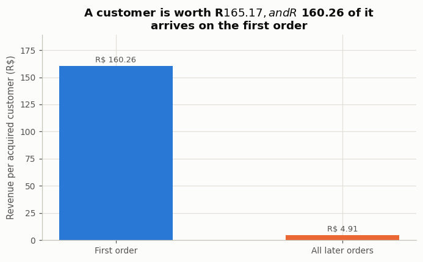
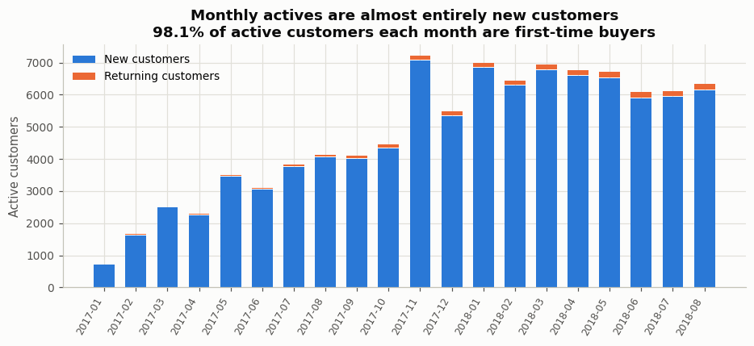
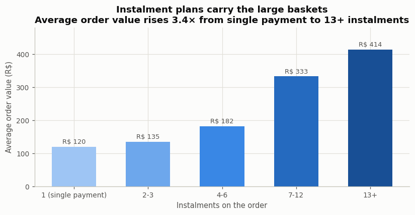

# Business insights — the reasoning behind each recommendation

*Author: Pranit Ajay Chaudhari*

All figures come from `outputs/tables/*.csv` and reproduce identically in Python, MySQL and Excel.

---

## Part A — a business that cannot be retained into growth

### 1. The loyalty programme that should not be built

Of 93,350 customers, **90,549 (96.97%) ordered exactly once**. Repeat orders are 3.23% of orders and
**2.97% of revenue**. Decomposing what an acquired customer is worth:

| Component | Value |
|---|---|
| Average first-order value | R$ 160.26 |
| Probability of a second order | 3.00% |
| Average additional orders, given a repeat | 1.11 |
| Average value of a repeat order | R$ 146.86 |
| **Retention contributes** | **R$ 4.91** |
| **Total per acquired customer** | **R$ 165.17** |

**The decision this drives.** A loyalty programme, a win-back campaign, a retention team — each is
competing for a share of R$ 4.91 per customer. Even a programme that **doubled** the repeat rate
would add about R$ 5 per customer before its own cost. The same effort spent lifting first-order
value by 3% returns R$ 4.81 with no retention machinery at all.

This is the opposite of the standard playbook, and it is what the data says.

### 2. Customer experience is worth fixing — just not for retention

The usual argument is that fast delivery and happy customers produce repeat purchase. It does not
hold here:

| Comparison | Repeat rate | Difference | z | p | Verdict |
|---|---|---|---|---|---|
| On time vs late first delivery | 3.03% vs 2.55% | 0.49 pp | 2.19 | 0.0286 | significant, negligible |
| 5-star vs 1-star first review | 3.11% vs 2.87% | 0.24 pp | 1.26 | 0.2071 | not significant |

Delivery speed bands tell the same story: repeat rate runs 2.74% → 3.00% → 3.08% → 3.13% → 2.77%
across 0–3, 4–7, 8–14, 15–21 and 22+ days. **Not monotonic, and the whole range spans 0.4
percentage points.**

**The decision this drives.** Keep fixing delivery — late orders drive 1-star reviews (36.6% of
1-star first orders were late, against 1.9% of 5-star ones), and reviews drive marketplace
reputation and seller quality. But **do not fund it from a retention business case**, because the
retention return is not there. Fund it as reputation and refund-cost management.

### 3. Where to acquire

| State | Revenue share | AOV | Freight share | Delivery days | Review |
|---|---|---|---|---|---|
| SP | 37.4% | R$ 142.48 | 12.2% | 8.3 | 4.23 |
| RJ | 13.3% | R$ 166.42 | 14.4% | 14.9 | 3.95 |
| MG | 11.8% | R$ 160.18 | 14.7% | 11.6 | 4.18 |
| BA | 3.8% | R$ 181.54 | 16.5% | 18.9 | 3.91 |
| CE | 1.7% | R$ 208.41 | 17.5% | 20.8 | 3.94 |
| MA | 0.9% | R$ 206.26 | 20.8% | 21.4 | 3.76 |

A clean gradient: **the further from São Paulo, the larger the basket and the worse the economics.**
Maranhão customers spend 45% more per order than São Paulo customers, but freight eats 20.8% of
revenue, delivery takes 21 days and reviews are the lowest in the country.

**The decision this drives.** Acquisition spend returns more per rupee in the south-east, where
freight is cheap and delivery is fast. The north-east is not a marketing opportunity yet — it is a
**logistics problem**, and the larger basket says the demand is real and waiting for someone to
serve it properly.

### 3b. Growth is acquisition, month after month

Across Jan 2017 – Jul 2018 the share of monthly active customers who were first-time buyers never
falls below 96.98%. Revenue grows because more new people arrive, not because anyone comes back.
A retention programme would be optimising a line that is 2–3% of the chart.

### 4. Instalments are a basket lever, not a discount

| Instalments | Orders | Share | Average order value |
|---|---|---|---|
| 1 (single payment) | 46,813 | 48.5% | R$ 120.21 |
| 2–3 | 22,157 | 23.0% | R$ 135.40 |
| 4–6 | 15,736 | 16.3% | R$ 181.82 |
| 7–12 | 11,584 | 12.0% | R$ 332.85 |
| 13+ | 179 | 0.2% | R$ 414.31 |

**The decision this drives.** Instalment availability costs no margin and is associated with baskets
3.4× larger. Promote it on high-ticket categories. The caveat: this is association, not proof —
expensive items are the ones people finance.

### 5. The real concentration risk is sellers, not customers

2,970 sellers. The **top 1% take 25.5% of revenue**, the top 10% take 66.3%, and **133 sellers
produce half of everything sold**. Against a customer base where the top 20% carry 53.5%, the seller
side is far more concentrated.

**The decision this drives.** In a marketplace with no customer loyalty, the **supply side is the
moat**. Losing one of the top 30 sellers costs more than losing thousands of one-time buyers. Seller
retention deserves the budget that customer retention cannot justify.

---

## Part B — a business where campaigns do work

### 6. Where the campaign budget goes

| Tier | Customers | % of base | % of spend | Response rate | Lift |
|---|---|---|---|---|---|
| Best | 299 | 14.8% | 32.0% | 33.78% | 2.21× |
| Core | 623 | 30.8% | 50.4% | 17.82% | 1.16× |
| Occasional | 587 | 29.0% | 14.9% | 13.12% | 0.86× |
| Marginal | 517 | 25.5% | 2.7% | 4.06% | 0.27× |

**The decision this drives.** Best and Core are 45.6% of customers, **82.4% of spend** and both
respond at or above the base rate. The Marginal tier is a quarter of the base, 2.7% of spend, and
responds at 0.27× — **suppress it from paid contact**, because the contact cost is not recovered.

### 7. Discount dependence destroys the economics

| | Customers | % of base | % of spend | Spend per purchase | Avg income | Response |
|---|---|---|---|---|---|---|
| Full-price | 1,332 | 65.8% | 89.7% | R$ 43.45 | R$ 60,216 | 16.37% |
| Deal-driven | 694 | 34.2% | 10.3% | R$ 12.22 | R$ 36,310 | 13.26% |

A third of the base produces a tenth of the spend. A deal-driven basket is worth **3.6× less per
purchase**, and these customers respond *less* often than full-price ones despite being the group
discounts are aimed at.

**The decision this drives.** Discount-led contact to this group buys volume at a margin the basket
does not support. Move them to non-price offers — bundles, loyalty, range — or stop contacting them.
This is the clearest margin-protection action in the project.

### 8. Campaigns are not interchangeable

| Campaign | Rate | Avg spend of accepters | % with children | Avg RFM of accepters |
|---|---|---|---|---|
| 1 | 6.52% | R$ 1,492 | 22.7% | 11.98 |
| 2 | 1.28% | R$ 1,324 | 34.6% | 11.50 |
| 3 | 7.45% | R$ 721 | **70.2%** | **9.34** |
| 4 | 7.65% | R$ 1,104 | 60.0% | 10.99 |
| 5 | 7.16% | R$ 1,615 | 15.2% | 11.94 |

Campaigns 1 and 5 reach **affluent, mostly childless, high-RFM** customers. Campaign 3 reaches a
different population — **70% have children, they spend half as much, and their RFM is 2.6 points
lower**. The Marginal tier accepted campaigns 1 and 5 **zero times** but accepted campaign 3 at
6.58%.

**The decision this drives.** Campaign 3's offer is the only one that reaches down the value
distribution. Judging all six on a blended response rate would hide that, and would retire the one
campaign capable of developing lower tiers. Match offer to segment, and measure per segment.

### 9. Income and children predict response better than behaviour

| Income band | Customers | Avg spend | Response rate | Lift | Deal share |
|---|---|---|---|---|---|
| Under 25k | 220 | R$ 73.50 | 11.36% | 0.74× | 27.9% |
| 25–45k | 598 | R$ 136.24 | 11.71% | 0.77× | 25.1% |
| 45–65k | 594 | R$ 574.58 | 11.45% | 0.75× | 18.3% |
| 65–85k | 523 | R$ 1,248.07 | 20.08% | 1.31× | 8.0% |
| **85k+** | 91 | R$ 1,527.65 | **46.15%** | **3.02×** | 5.0% |

Customers **without children** respond at 27.59% against 10.50% with children, and spend R$ 1,118
against R$ 408.

**The decision this drives.** Income and household composition are known before any campaign is
sent, so they can target the *first* contact, where behavioural scores are unavailable. Note the
mirror image: deal share falls from 27.9% to 5.0% as income rises — **the customers who need
discounts to buy are the ones least worth discounting to.**

---

## The synthesis

Put the two together and the argument is this:

> **Retention marketing is not a universal good — it is a strategy that requires a repeat base to
> exist.** Part A is a business where it cannot work: 97% of customers never return, and the entire
> retention opportunity is worth R$ 4.91 per customer. Part B is a business where it demonstrably
> does: the top tier responds at 2.21× the base rate and carries a third of spend.
>
> The first question a marketing team should ask is not *how do we segment our customers* but
> **does this business have the repeat behaviour that segmentation assumes?** Part A shows what
> happens when you skip that question — you get an elegant RFM grid in which 97% of customers share
> one frequency score, and a retention plan with nothing to retain.
